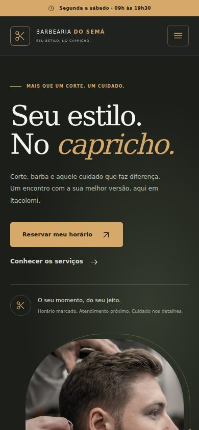

# Renovação do frontend

**Data:** 21/10/2026  
**Base:** `6c4939a33d56d4df579caf24fbbf9995ebd18c43`  
**Ambiente:** Linux, Node.js 24.19.0, npm 11.9.0 e Chromium pelo Playwright do projeto.

## Interface

O layout foi reorganizado para destacar a apresentação da barbearia e o acesso à reserva. A paleta verde escuro, creme e dourado permanece, com novos espaçamentos, hierarquia tipográfica, cartões de serviços, seção de experiência, galeria e contato. Preços, durações e regras da agenda foram preservados.

Os ícones são SVG definidos no próprio HTML, sem biblioteca ou fonte de ícones. As quatro fotografias são arquivos WebP locais, reutilizados entre a abertura, a apresentação e a galeria. A [página de créditos](../public/creditos-fotografias.html) identifica autores, originais e licença. As imagens são ilustrativas e não representam a barbearia real.

No celular, o menu fecha após a escolha de uma ação, ao clicar fora ou pressionar Escape. O atalho fixo de reserva aparece quando a abertura e o agendamento estão fora da tela e se recolhe durante os modais. Controles recolhidos não participam da navegação por Tab.

A galeria amplia as fotos e permite avançar ou voltar com botões e setas. Escape fecha a janela. Os modais mantêm a navegação por Tab em seu conteúdo e restauram o foco ao fechar. A preferência por movimento reduzido desativa as animações.

## Organização

| Arquivo | Alteração |
|---|---|
| `public/index.html` | Estrutura visual, ícones, fotos, galeria e atalho móvel; seletores dos formulários preservados |
| `public/styles.css` | Tokens de cor, componentes, estados e adaptação a diferentes larguras |
| `public/images/` | Quatro fotografias locais em WebP |
| `public/creditos-fotografias.html` | Créditos e identificação do uso ilustrativo |
| `public/js/gallery.js` | Navegação e ampliação de fotos |
| `public/js/page.js` | Menu, atalho móvel, animações e teclado dos modais |
| `public/js/core.js` | Restauração de foco e estado compartilhado dos modais |
| `public/js/booking.js` | Descrições acessíveis das pendências compactas do formulário |
| `public/js/admin.js` | Ícones e nomes acessíveis dos controles de remoção |
| `public/app.js` | Inicialização da galeria |
| `test/frontend-design.browser.test.js` | Seis cenários adicionais de navegador |

Não foram acrescentadas dependências. Servidor, API, banco de dados e regras de negócio não foram alterados nesta etapa.

## Validação

| Verificação | Resultado |
|---|---|
| Suíte existente com a nova interface | 98 aprovados, zero falhas e zero pulados |
| Seis cenários novos de navegador | Fotos locais e ícones, galeria e teclado, Tab, menu móvel, atalho de reserva e movimento reduzido aprovados |
| `REQUIRE_BROWSER_TESTS=1 npm test` | 104 aprovados, zero falhas, cancelados ou pulados |
| `npm run lint` | Zero erros ou avisos |
| `git diff --check` | Aprovado |
| Capturas em 1440×1000, 768×1024, 390×844 e 320×740 | Sem rolagem lateral e sem erros JavaScript |
| Fotografias com requisições externas bloqueadas | Todas as sete ocorrências de imagens na página carregadas a partir dos quatro arquivos locais |

A suíte inclui criação, consulta por telefone ou e-mail, remarcação, cancelamento, ações administrativas e cenários de rede. A validação usou bancos isolados e transporte de e-mail simulado.

As capturas foram realizadas com animações estabilizadas. As prévias abaixo usam as fontes alternativas locais porque o serviço externo de fontes não carregou no ambiente. A composição com as fontes remotas não foi inspecionada nessas capturas. Não houve verificação em aparelhos físicos, Safari ou Firefox. Merge e publicação permanecem fora desta etapa.

## Prévias

